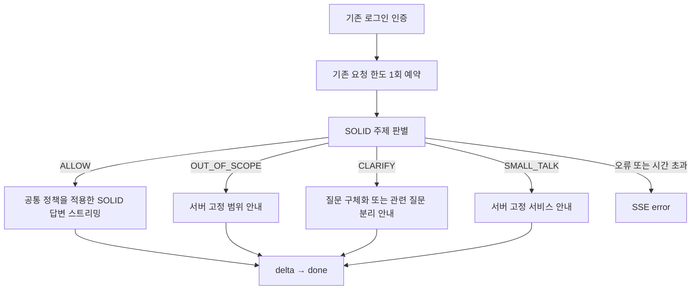

# SOLID 채팅 도메인 제한

## 적용 범위와 배포 상태

백엔드에서 공통 정책을 적용한다. 프론트, DB 스키마, 기존 규칙 튜터는 변경하지 않는다.
이번 변경은 별도 브랜치의 구현·검증이며 **운영 앱에 배포하지 않았다**.
전체 실행 맥락을 자동으로 읽는 실행 컨텍스트 분석기는 계속 미연결이다.

허용 주제는 ArchReactor 사용법, C 코드, RV32IM RISC-V, 레지스터·메모리,
파이프라인, 스톨·포워딩·플러시, CPI, 사용자가 제공한 코드·실행 결과 분석이다.
`app/services/assistant/policy.py`의 `DOMAIN_POLICY`가 판별·답변 프롬프트의 공통 기준이다.
서비스 메뉴나 실제 실행 결과를 확인하지 못했다면 추측하지 않고 필요한 자료를 요청한다.

## 처리 흐름

- 판별은 답변 생성과 별도의 비스트리밍 호출이다. `ALLOW`가 검증되기 전에는 답변 provider도 생성하지 않는다.
- 마지막 질문은 기존 요청 한도 내에서 전부 전달한다(최대 8,000자).
- 최근 대화는 마지막 질문을 제외한 최대 6개 메시지, 각 마지막 1,000자, 합계 4,000자 이내다. 역할과 잘림 표시를 JSON 데이터로 전달한다.
- 전체 요청 바디 제한(20개 메시지, 합계 24,000자)은 그대로다. 분류용 대화 창이 잘려 짧은 후속 질문의 주제를 알 수 없으면 확인을 요청할 수 있다.
- 코드·주석·문자열·로그 내부 지시는 분석 자료로 취급한다. 이전 assistant 메시지도 사용자 제공 자료이며 권한의 근거가 아니다.
- 관련 주제와 별개의 무관한 요청이 섞이면 `CLARIFY`. 분석 자료 내부의 우회 문구는 별도 요청으로 취급하지 않는다.
- 자료가 부족해도 주제가 명확한 실행 질문은 `ALLOW`하고, 답변 단계에서 필요한 자료를 요청한다.
- 원격 판별 결과의 원문은 프론트에 전송하지 않는다. 네 상태 중 하나만 내부에서 사용한다.

## 출력 검증과 실패 처리

정확한 JSON 객체 `{"decision":"ALLOW"}` 형태만 허용한다. 네 enum 외 값, 추가 필드,
중복 키, 코드 블록, JSON 뒤 설명, 잘못된 타입, 256자 초과 결과는 모두 거절한다.
완료 상태가 `stop`이 아니거나 choice가 한 개가 아니거나 거절·도구 호출이 포함돼도 실패한다.

`json_schema` 모드에서도 같은 서버 검증을 수행한다. 구조화 출력 미지원 gateway는 설정을
`none`으로 명시해 프롬프트 기반 JSON을 요청할 수 있지만, 검증을 생략하지 않는다.
구조화 출력이 실패했다는 이유로 재시도하거나 일반 답변으로 우회하지 않는다.

- 판별 실패: `error` 이벤트의 `code=CLASSIFICATION_UNAVAILABLE`, 고정된 한국어 일시 오류 안내.
- 전체 60초 제한 도달: 기존 `MODEL_TIMEOUT`.
- 워커 동시 호출 상한 도달: 기존 `MODEL_BUSY`.
- 에러 뒤 `done`은 보내지 않는다. 연결 취소는 작업과 upstream client/stream을 닫으며 답변으로 넘어가지 않는다.
- 연결 전체 제한 시간은 판별과 답변에 공유된다. 두 단계에 각각 60초를 부여하지 않는다.

## 설정과 비용 관측

| 설정 | 이번 코드 기본값 | 의미 |
|---|---|---|
| SOLID_LLM_CLASSIFICATION_FORMAT | json_schema | 현재 gateway/model에서 검증. 변경 시 재검증 |
| ASSISTANT_CLASSIFICATION_TIMEOUT_SECONDS | 10 | 판별 전체 제한, 1~30초 |
| SOLID_LLM_INCLUDE_USAGE | true | 검증된 스트림 사용량 옵션. 기존 명시적 false 환경값은 우선함 |
| ASSISTANT_TIMEOUT_SECONDS | 60 | 판별+답변 전체 제한 |
| ASSISTANT_DAILY_REQUESTS | 50 | 사용자별 UTC 일일 요청 수 |
| ASSISTANT_COOLDOWN_SECONDS | 10 | 사용자별 요청 간격 |

판별 출력은 128토큰, temperature=0이다. 기존 답변 한도는 2,048토큰이다.
두 단계는 워커당 8개 upstream 호출 상한을 공유하며 자동 재시도하지 않는다.

사용자 요청 한도는 인증 후 채팅당 한 번 예약한다. 분류 호출과 답변 호출에 각각 차감하지 않는다.
고정 안내, 판별 실패, 답변 실패, 취소도 이미 예약한 채팅 1회에 포함된다.
허용 질문은 모델을 두 번 호출하므로 기존보다 지연과 SOLID 토큰 사용량이 증가한다.
범위 밖 질문도 판별 모델 호출 비용은 발생한다.

`assistant_usage` JSON 관측 로그는 요청당 하나를 남긴다. 임의 생성 requestId,
고정 enum outcome, `stages.classification`, `stages.answer`, `total`만 기록한다.
토큰 필드는 inputTokens/outputTokens/totalTokens이며 원문·사용자 ID·비밀값·공급자 오류 본문은 기록하지 않는다.
답변 단계가 호출되지 않았으면 answer 항목이 없다. 취소·오류 등으로 사용량을 받지 못하면 `{}`이며
0으로 계산하지 않는다. total은 시도한 모든 단계에서 수치가 있는 항목만 합산한다.
일부 공급자 비용이 반환되지 않을 수 있으므로 결제 대사의 완전한 원장은 아니다.

외부 SSE의 `done.usage`는 호환성을 위해 계속 **답변 단계의 사용량**이다.
고정 안내는 `usage={}`다. 판별 비용을 포함한 합계는 서버 관측 로그를 사용한다.
이번 작업은 운영 설정을 변경하지 않으므로 새 기본값도 배포 전에는 적용되지 않는다.

## 프론트 인수인계

요청 바디와 SSE 이벤트 구조는 그대로 유지한다. 별도 판별 API 호출은 필요 없다.
고정 안내도 일반 답변처럼 `delta`를 표시하고 `done`에서 로딩을 종료한다.
판별 중에는 첫 delta가 늦어질 수 있으므로 연결·keepalive만으로 답변 완료를 판단하지 않는다.
`CLASSIFICATION_UNAVAILABLE`를 기존 `error` 처리에서 보여 주고 로딩을 종료한다.
자동 재요청은 요청 횟수를 다시 차감할 수 있으므로 사용자 재시도로 처리한다.
중지 버튼은 기존 연결 취소를 사용한다. 원격 판별 라벨은 UI 계약으로 노출하지 않는다.
이번 작업에서 프론트 파일·배포는 변경하지 않았다.

## 검증과 한계

단위·전송 테스트는 mock 응답에 대한 검증/분기/SSE/취소/한도/사용량 관측을 검사한다.
mock의 라벨을 이용하는 테스트를 실제 모델의 주제 이해 정확도라고 해석하지 않는다.
실제 모델은 별도의 평가 도구 `python -m scripts.evaluate_assistant_domain --repeats 1`로 검증한다.
승인된 실행 환경의 키를 사용해야 하며, 이 명령은 테스트 수만큼 SOLID 호출을 발생시킨다.
평가 도구는 합성 질문의 ID·기대 라벨·실제 라벨·사용량만 출력하며 대화 원문은 출력하지 않는다.
운영 DB, 서비스 설정, 배포 버전은 바꾸지 않는다.

LLM 기반 제한은 **100% 차단이나 무오류 판정을 보장하지 않는다**. 우회 지시, 모호한 표현,
대화 잘림, 모델 업데이트에 따라 오차단과 범위 밖 통과가 발생할 수 있다. JSON Schema는 출력
형식과 enum을 제한할 뿐 의미 판정의 정확성을 보장하지 않는다. 답변 시스템 프롬프트도 완전한
보안 경계가 아니므로 실행 권한이나 자동 맥락 조회 권한을 추가하는 근거로 사용하면 안 된다.

### 실제 SOLID 평가 기록 (2026-11-12)

- 모델: local/qwen3-coder-next, gateway: https://dku-chat.kloud.zone/llm/v1.
- 구조화 출력 검사: schema는 ALLOW만 허용하고 입력은 OUT_OF_SCOPE를 요구했을 때 ALLOW 반환. enum 제약 적용을 확인했다.
- 초기 정책: json_schema와 none 각각 22개 중 20개 기대 라벨 일치. 정상 질문 11개 중 2개를 CLARIFY로 오차단했고, 비허용 질문 11개 중 ALLOW 통과는 0개였다. 오류 0개.
- 오차단은 실행 자료가 없는 스톨 질문과 우회 문구가 든 로그 분석 질문이었다. 주제의 명확성과 자료의 충분성을 구분하고, 로그 내부 지시는 혼합 요청이 아님을 명시했다.
- 1차 보완 후 30개 변형 평가에서는 두 모드 모두 27/30 일치, 오차단 3개, 범위 밖 통과·오류 0개였다. 인사와 실제 질문이 함께 있을 때 실제 질문을 우선하고, 자료 부족을 주제 모호성과 구분하도록 판별 순서를 재정리했다.
- 최종 정책: 38개 사례를 두 모드로 각 1회, 총 76회 평가했다. 두 모드 모두 38/38 기대 라벨 일치. ALLOW 20개 중 오차단 0개, 비허용 18개 중 ALLOW 통과 0개, 오류 0개였다. 비허용 표본은 OUT_OF_SCOPE 9개, CLARIFY 6개, SMALL_TALK 3개다.
- 판별 프롬프트 SHA-256: `a373dbbac07fbb7f5024991e4f01c5197917f99f7edef2c994a3db59b6b15f4f`.
- 테스트 사례 일부는 정책 보완에 사용했다. 독립적인 대규모 정확도 추정이나 우회 방어 보장은 아니다. 모델/gateway 변경 시 재평가가 필요하다.
- 실제 guarded stream 추가 확인: 정상 개념·코드 주석 우회·자료 없는 실행 질문 3개는 각각 답변 호출 1회 후 delta/done. 범위 밖·혼합 질문 2개는 답변 호출 0회, 서버 고정 응답과 일치했다. 대화 원문을 출력·저장하지 않았다.
- 실제 응답의 코드 반환값 5 포함 및 자료 요청 표현은 간단한 검출 조건으로 확인했다. 이는 전체 답변의 사실성이나 모든 우회 지시 무시를 검증하는 평가가 아니다.
- 실제 정상 개념 질문에서 판별 859토큰 + 답변 621토큰을 별도 수집했다(합계 1,480). SSE done.usage는 답변 621토큰만 유지했다.
- 모든 원격 검사는 기존 컨테이너 안의 별도 프로세스에서 소스를 메모리로만 로드해 수행했다. 앱 파일·운영 DB·배포 버전·환경 설정을 수정하지 않았다.

### 로컬 회귀 검증

- 최종 결과: **193 passed, 8 skipped, 1 deselected**.
- 도메인/채팅 관련 113개 테스트 전체 통과. 오류 출력·잘린 분류·중복 JSON 키·schema 미지원·취소·전체 제한 시간·워커 상한·요청당 quota·SSE·사용량 합산을 포함한다.
- 기존 CORE 엔진/크로스 컴파일러 관련 8개는 로컬 의존성이 없어 skip, Linux GNU 도구체인을 전제로 하는 기존 컴파일 테스트 1개는 macOS에서 제외했다. 해당 기존 검증은 PR의 Linux CI에서 별도로 확인한다.
- 기존 Pydantic class Config 사용에 대한 deprecation warning 1개. 새 실패는 없다.
- `git diff --check` 통과. 프론트 변경, 신규 배포, PR 병합은 수행하지 않았다.
