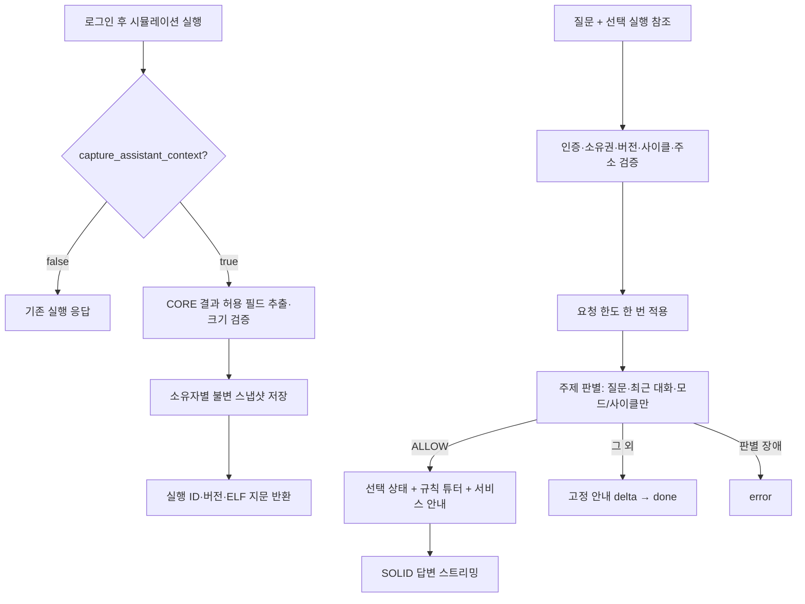

# 선택 실행 맥락 연결

## 범위와 상태

이 변경은 백엔드 구현과 별도 PR이다. 새 PR의 병합·운영 배포 및 프론트 수정은 수행하지 않는다. 앞선 도메인 제한 PR #8은 사용자가 병합했고, 2026-11-12 서울 운영 환경이 `8c23f8d` 버전에서 Ready/Green임을 확인했다.

AI가 전체 실행을 자율적으로 조회하는 에이전트가 아니라, **사용자가 질문을 보낸 시점에 선택한 실행·사이클의 자료를 제공하는 기능**이다. 도메인 제한은 계속 적용한다. 모델의 실행·수정 도구는 없다.

- 전달: 선택 사이클 처리 후 레지스터 32개, PC, 누적 완료 명령어/스톨/포워딩, CPI, 파이프라인 단계, CORE 이벤트, 명시적으로 선택한 메모리 워드, 해당 명령어와 이벤트의 기존 규칙 기반 튜터 해설.
- 별도 표기: 전체 실행의 사이클·명령어·스톨·포워딩 요약과 CPI. 선택 시점의 누적값과 섞지 않는다.
- 제외: 화면, 전체 실행 이력, 전체 메모리 덤프, 콘솔 출력, 내부 버퍼, 파일 경로, 사용자 정보, C 소스 원문, 컴파일 당시의 C 줄별 해설, 임의의 다른 실행 검색.
- 이번 튜터 연결은 `simulation_explanations`의 명령어 및 스톨·포워딩·플러시 해설이다. 컴파일 결과의 `c_lines`는 저장된 소스 버전과 연결하는 별도 설계가 필요하다.
- CORE는 `program.code_mapping`을 반환하지 않으므로 같은 실행의 `stage_activity`에서 PC/명령어/DWARF 줄 번호를 투영하여 기존 해설 규칙을 재사용한다. 줄 번호가 없다는 이유만으로 CRT라고 단정하는 해설은 제외한다.
- 서비스 사용법은 `knowledge.py`의 검증된 백엔드 기능 안내를 사용한다. 프론트 메뉴 이름은 추정하지 않는다.

## 처리 흐름

기존 메시지만 보내는 채팅과 비로그인 시뮬레이션은 그대로 동작한다. 맥락을 해석할 수 없으면 관련 질문을 자료 없이 모델로 넘기는 식으로 조용히 대체하지 않는다. 사용자에게 오류를 알려 다시 선택하게 한다.

## 저장·권한·최소 전송

신규 `assistant_executions` 테이블은 로그인 사용자가 `capture_assistant_context=true`로 실행했을 때만 기록한다. 저장 빌드는 기존 프로젝트 소유권 확인을 유지한다. `simulation_token`으로 실행해도 로그인한 요청자에게 그 실행의 스냅샷이 귀속된다. 토큰은 기존 익명 실행 기능의 바이너리 접근 권한이며 원본 파일 소유권을 의미하지 않는다.

- 기본 보존: 사용자당 최근 3개, 30분. 환경변수 `ASSISTANT_CONTEXT_MAX_SNAPSHOTS`(1~5), `ASSISTANT_CONTEXT_TTL_SECONDS`(60~3600).
- 서버 저장 상한: 스냅샷당 JSON UTF-8 2 MiB, 최대 2000사이클, 메모리 상태당 최대 2048워드. 초기 상태와 변화분을 저장한다. 모델에는 재구성한 **선택 주소만** 전달한다.
- 모델 전달 상한: 맥락 JSON UTF-8 16 KiB, 메모리 최대 16개 4바이트 정렬 워드. 중복/음수/범위 밖/미제공 주소는 거절한다. 제공되지 않은 메모리를 0으로 간주하지 않는다.
- 실행 ID와 로그인 소유자를 함께 조회한다. 다른 사용자의 ID와 존재하지 않는 ID는 모두 404다.
- ELF SHA-256, 스냅샷 SHA-256, 모드를 모두 검증하고 저장 자료의 해시도 재검산한다. 모델에 사용자 ID/이메일/스토리지 키를 보내지 않는다.
- 모델 호출이나 DB 로그에 대화·스냅샷·비밀값을 새로 기록하지 않는다. 스냅샷은 기능상 DB에 보관되며, SOLID에는 허용된 자료가 외부 전송된다. 따라서 “데이터 유출 가능성이 없다”는 보장은 하지 않는다. 기관의 SOLID 보관·학습·접근 정책은 별도 확인이 필요하다.
- 만료된 자료는 즉시 읽기 거절한다. 앱 수명 주기 작업이 60초마다 최대 500건씩 삭제한다. 장애/누적 시 물리 삭제는 늦어질 수 있으나 읽기는 허용하지 않는다. 백업 보존 기간은 별도 인프라 정책이다. 삭제 작업 실패는 고정 로그만 남긴다.
- 동일 사용자의 동시 실행은 사용자 행 잠금으로 보관 개수를 직렬화한다. 오래된 응답이 도착했을 때 이미 최신 실행들에 밀려 삭제된 경우 다시 선택/실행해야 한다.

## 데이터 일치의 경계

지문은 **실제로 실행한 ELF**에 대한 것이며 편집 중인 C 텍스트의 해시가 아니다. 서버는 전송받지 않은 프론트 편집 상태를 알 수 없다. 따라서 프론트가 코드 편집, 재컴파일, 모드 변경, 다른 실행 선택 때 참조를 해제해야 한다. 사용자가 이전 지문과 이전 실행을 함께 보내면 서버는 그것을 유효한 과거 실행으로 해석한다.

CORE clock은 0부터 시작하고 `after_cycle`은 그 클록 처리 후 상태다. cycle=0의 경과 클록 수는 1이다. 선택 CPI는 `(cycle + 1) / accumulated_instructions`, 완료 명령어가 0이면 null이다. 전체 CPI는 별도로 `total_cycles / instructions_executed`를 사용한다. CYCLE_LIMIT/SIMULATION_ERROR 결과도 저장 가능하며 해당 상태를 모델에 알린다.

## 운영과 검증

`f821a73d9001` 마이그레이션이 기존 마지막 리비전 다음에 테이블과 인덱스를 추가한다. 정상 앱 시작 시 기존 마이그레이션 실행 흐름을 사용한다. 스냅샷 저장 실패는 원래 시뮬레이션 결과를 보존하고 `available:false`를 반환한다. 롤백은 먼저 앱을 이전 버전으로 내리고 새 테이블은 그대로 둘 수 있다. 명시적 downgrade는 스냅샷 테이블만 삭제하며 실행 기록이나 사용량 테이블은 건드리지 않는다.

현재 일일 요청 수와 요청 간격은 동일하다. 유효한 채팅 요청당 한 번 차감하며, 맥락 오류는 모델 호출/차감 전에 반환한다. 스냅샷 생성은 LLM을 호출하지 않는다. ALLOW는 판별+답변 두 호출, 그 외는 판별 한 호출이다. 두 단계의 전체 제한 시간·연결 취소 처리는 기존 경로를 유지한다.

`assistant_usage`는 판별/답변별 토큰과 합산 가능한 총량, 결과, 전체 `elapsed_ms`, `stage_usage_received_ms`를 기록한다. 후자는 단계 시작에서 마지막 사용량 콜백까지의 시간이며 완전한 단계 지연 측정값은 아니다. 사용량 미제공은 0으로 꾸미지 않는다. 프로세스별 동시 호출 8개는 SOLID 계정 전체 한도가 아니다. 다중 워커/다른 앱을 포함하는 공유 한도, 비용 경보 및 대시보드 구축은 별도 운영 작업으로 남는다.

- 로컬: PostgreSQL 마이그레이션/동시 저장, 권한·버전·크기·만료·정리, SSE/요청 한도/취소/판별 장애 회귀.
- 실제 CORE: 고정 커밋 `7e9e6c856522f4af4c2e62a7fc3b2f1074ad228c`의 `tests/program2.elf`, single 97 및 pipeline 134사이클의 모든 선택 상태를 대조한다.
- 모델 실평가: `python -m scripts.evaluate_assistant_context`. 합성 실행 픽스처만 사용하며 답변 원문을 저장하지 않는다. 수치·원인 코드·포워딩 경로·플러시 대상 추출 및 자료 부족 시 유보를 평가한다. 자연어 설명의 모든 의미를 평가하는 것은 아니다.
- 프롬프트 기반 제한과 LLM 답변은 100% 차단/정확도를 보장하지 않는다. 최초 실평가에서 자료 없는 CPI 질문의 오차단을 발견해 판별 예시를 보완했다. 모델/게이트웨이 변경 때 기존 도메인 평가와 맥락 평가를 모두 재실행한다.

프론트 구현/배포는 보류 상태다. [프론트 연결 계약](execution-context-handoff.md)을 담당자에게 전달한다.

### 2026-11-12 검증 기록

로컬 전체 테스트 244개 통과, RISC-V 컴파일러 미설치로 1개 건너뜀, macOS GNU 어셈블러 차이로 기존 테스트 1개 제외. Linux CI에서 전체 테스트를 실행한다. 최종 SOLID 맥락 평가 12/12, 도메인 평가 38/38(오차단 0, 범위 밖 통과 0, 판별 오류 0).

첫 실행은 11/12(자료 부족 CPI 질문 오차단)이었고 판별 예시를 보완했다. 중간 반복은 최종 상태 추출 두 건이 불일치로 기록됐다(10/12). 원문을 보관하지 않아 이 두 응답의 정확한 불일치 원인은 확정하지 못했다. 평가기의 16진수 비교를 문자열 형태가 아닌 숫자 동등성으로 보완한 최종 실행은 12/12다. 한 번 통과했다고 모델 변동성이나 모든 의미 오류가 해소된 것으로 간주하지 않는다. [원문 없는 평가 기록](execution-context-evaluation.json)을 함께 참고한다.
